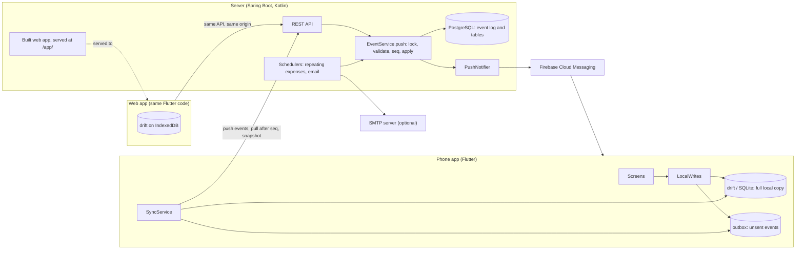

# Architecture

This is how Evensies works and why it is built this way. The exact rules (every endpoint, event, payload and applier rule) are in [docs/API.md](docs/API.md), the contract both implementations follow. When this page and API.md disagree, API.md wins.

## System overview

- **The app** (`app/`) is one Flutter code base for iOS, Android and the web. It keeps a full copy of every group the user is in and computes balances itself, so adding and editing expenses, payments and comments works offline; creating or joining groups, adding friends, moving expenses, leaving a group and account settings need a connection.
- **The server** (`server/`) is a Spring Boot application in Kotlin on PostgreSQL. It orders and validates changes, keeps the authoritative event log, and also sends push notifications and email, posts repeating expenses and serves the web app.
- **`shared/`** holds JSON test cases and tables that both implementations load, so the Dart and Kotlin code are checked against the same expected results.

## Sync model

### An append-only event log per group

Every change is an event: `expense.created`, `expense.updated`, `payment.confirmed`, `member.added` and so on (the full list is in [Event types and payloads](docs/API.md#event-types-and-payloads)). Each group has its own log, and the server gives each event the next sequence number (`seq`) in that group. Syncing is then two operations:

- **push** (`POST /groups/{id}/events`): send my new events;
- **pull** (`GET /groups/{id}/events?after=N`): get everything after the last `seq` I have, 500 events per page.

A **snapshot** (`GET /groups/{id}/snapshot`) returns the current state of a group in one response. The app uses it when it first sees a group (a new device, or a group joined elsewhere) and to rebuild a group after the server refused one of its events.

The log also gives the activity feed, the edit history of an expense, restoring deleted expenses and payments, and full exports for free: they are all views of the same events.

### Ordering: the server, not the clock

The order of events is the order the server stored them, never a device clock. A wrong clock on one phone would otherwise put a later edit before an earlier one, and devices could disagree about the result.

A push is one database transaction (`EventService.push` in `server/src/main/kotlin/dev/nariinfo/evensies/sync/EventService.kt`):

1. Lock the group row with `SELECT … FOR UPDATE`.
2. Load the group's state and validate the whole batch against it, under the lock. If any event is invalid, the whole batch is refused (400, 403 for a permission problem, or 409 for a limit) and nothing is stored.
3. For a client id that is already stored, return the `seq` it got the first time.
4. Give each new event the next `seq`, apply it to the tables (members, expenses, shares, payments, comments, receipts, repeating series) and store it with the data the activity feed needs.
5. Update the group's latest `seq` and commit. Push notifications go out after the commit.

The `seq` is handed out under the lock and committed in the same transaction. With a plain database sequence, event 12 could commit after event 13, and a device that pulled "after 11" in between would get 13 and skip 12 forever. Under the lock, `seq` values become visible strictly in order and without gaps.

Validating under the lock avoids check-then-act races: two `attachment.added` pushes that both see nine receipts on an expense cannot end with eleven, because the second one is checked after the first is stored. Locks are per group, so groups never wait for each other, and the lock lives in Postgres, so it holds across server instances too.

The trade-off: "last write wins" means last to reach the server, not last typed. An edit made offline yesterday and synced today wins over one made online this morning.

### Idempotent retries

The app generates every id before sending: expense, payment, member and comment ids, and a `clientId` for each event. A retry after a timeout carries the same ids. The server has a unique constraint on `(group_id, client_id)`, and a duplicate is not an error: it returns the `seq` the event already has. So the app just sends until it gets a `seq`, and an expense is never stored twice.

Generating ids on the device also means an expense has an id while it exists only offline, so comments and receipts can refer to it right away. Authorization never relies on these ids: the server checks the signed-in user's membership; a creating event whose id already exists in another group is refused, and any other event that points into another group changes nothing.

### Applying events

`applyEvent(state, event)` is a pure function with the same rules in Dart (`app/lib/data/sync/apply_event.dart`) and Kotlin (`server/.../sync/EventApplier.kt`), checked by `shared/sync-cases.json`. The [applier rules](docs/API.md#applier-rules) in API.md are numbered; the important ones:

- **Idempotent.** Applying an event twice gives the same state as applying it once; a `*.created` for an id that exists changes nothing.
- **Field-level last write wins.** `expense.updated` carries only the fields that changed. Applied in `seq` order, the later value of each field wins, so two people editing different non-money fields of one expense (description, date, category, notes) both keep their change. The six money fields (`amount`, `paidBy`, `payers`, `shares`, `split`, `refund`) travel together as one unit, and so do the currency and its rate, so the later money edit replaces the earlier one.
- **Delete wins.** An update that arrives for a deleted expense or payment is ignored, and stays ignored after a restore. Only an explicit `expense.restored` or `payment.restored` brings a row back.
- **Missing targets are ignored.** An update, delete or confirmation for something that doesn't exist does nothing, so an offline device can't break a group.
- **Removed members stay.** Removing a member only marks them removed; their expenses still count in balances.

### Offline writes and the outbox

Most local changes (`app/lib/data/local_writes.dart`) write the new rows to the local database and an event to the outbox in one step, then ask for a sync in the background. The screen shows the change at once. The online-only writes skip the outbox: leaving a group is pushed directly, and a move pushes the new expense to the target group before the source's delete goes into the outbox.

A sync (`app/lib/data/sync/sync_service.dart`) uploads pending receipt photos, pushes the outbox in batches, pulls after the last known `seq` and folds the new events through the applier. If the server refuses a batch, the app resends it one event at a time, drops only the event that is refused on its own, tells the user what couldn't be saved, and rebuilds the group from a snapshot plus the events still waiting. Network errors, 401, 429 and 5xx keep everything in the outbox for the next try.

## Money core

The money code is small and pure. Every function that exists on both sides is checked by the same shared cases; the app-only parts (the itemized split, the Insights totals) have app-side cases.

| What | Dart (`app/lib/domain/`) | Kotlin (`server/.../money/`) | Test cases |
|---|---|---|---|
| Splitting an amount | `split.dart` | `Split.kt` | `shared/split-cases.json` |
| Balances and settling up | `settlement.dart` | `Settlement.kt` | `shared/settlement-cases.json` |
| Currency conversion | `fx.dart` | `Fx.kt` | `shared/fx-cases.json` |
| Balances per currency | `balances.dart` | `Balances.kt` | `shared/settlement-cases.json`, `shared/overview-cases.json` |
| Totals across groups | `overview.dart` | `Overview.kt` | `shared/overview-cases.json` |

### Integer minor units

Amounts are integers in the currency's minor unit, always paired with a currency code: EUR 1234 is €12.34, KRW 1234 is ₩1,234. The number of decimals per currency (155 of them) comes from `shared/currencies.json`, which the app and the server both load.

Floating-point numbers are binary, so most decimal amounts can't be stored exactly: sums drift (0.1 + 0.2 isn't 0.3) and half-cent rounding goes the wrong way (100 × 0.285 is 28.4999… as a double). Typed amounts go straight from text to an integer (`parseMoney` in `app/lib/core/money.dart`). Doubles appear only where a person types a ratio, such as a percentage, a share count or an exchange rate, and the code switches to integer arithmetic before it computes any amount. The one exception is the itemize screen's % helper (`percentOf`), which rounds one double product to a whole minor unit.

### Split modes as integer weights

`computeSplit` divides an amount among members. Equal, percent and shares are the same calculation: integer weights, each member gets `amount × weight ÷ total weight` rounded down, and the leftover minor units go out one at a time.

- **equal:** every ticked member has weight 1.
- **shares:** weight = share count × 100 (so 1.5 shares works).
- **percent:** weight = percent × 10⁶. The division uses the real total of the weights, not 100%, so the result can never add up to more than the amount, even when the typed percentages are slightly off within the allowed ±0.001%.
- **adjustment:** the adjustments are taken off the amount, the rest is split equally, then each member's adjustment is added back.
- **exact** amounts are stored as typed and must add up. **Itemized** splits each receipt line equally among its people and spreads tax, tip and discount by subtotal (app only, `app/lib/domain/itemized.dart`).

The modes stay separate because they mean different things to the person typing (percentages must add up to 100; share counts can be anything), not because the arithmetic differs.

### Deterministic remainders and stored shares

The leftover cents go to members in memberId order, never in list order. The same input gives the same shares on every device and on the server; otherwise two phones editing the same expense would store different numbers. In the equal, percent and shares modes a member gets at most one leftover minor unit per split; an itemized split, which hands out leftovers for each set of lines with the same people and again for the tax, tip and discount, can give one member several.

An expense stores the **final amount of each member**, plus a hint (`split`) that lets the editor reopen it in the same mode. The server checks that shares and payers add up to the amount and never recomputes a split. So fixing the algorithm or adding a member later never rewrites past expenses.

### Balances, payments and refunds

A balance is what you paid minus what you owe; positive means others owe you.

- An expense adds each payer's amount and subtracts each member's share. It adds zero in total, so all balances in a group always sum to zero (a randomised test on the server checks this, `server/src/test/.../SettlementTest.kt`).
- A payment from A to B is an expense that A paid and B owes in full: A's balance goes up, B's goes down.
- A refund (money that came back, say a hotel deposit) is the exact reverse of an expense. It is a flag (`refund: true`) rather than a negative amount, so the "amounts are never negative" checks, the display and the statistics stay simple.

Balances are kept **per currency**. Expenses in another currency are converted into the group's currency when they have an exchange rate; otherwise they stay in their own currency bucket, and Settle up shows that bucket separately, settled in its own currency. Nothing ever adds two currencies together.

### Settling up

With "simplify debts" on (the default), `simplifyDebts` works greedily: match the largest creditor with the largest debtor, transfer the smaller of the two amounts, and repeat, breaking ties by memberId. Each transfer clears at least one person, so there are at most n − 1 transfers, and the result is deterministic.

Greedy isn't always the minimum. With balances a −6, b −5, c +2, d +4, e +5 it makes four transfers, but three suffice ({b, e} and {a, c, d} each sum to zero). The true minimum is n minus the largest number of disjoint groups whose balances sum to zero, and finding those groups is NP-hard; a bitmask DP over subsets solves it in O(2ⁿ · n), which is fine for a dozen people but not for the 50 a group may hold. For real groups the greedy result is fast and stable.

With "simplify debts" off, `pairwiseDebts` settles each expense and payment on its own and nets the debts per pair of people, so everyone pays the people they actually owe.

### Exact currency conversion

`fxRateToDefault` is stored per expense as a number (major units of the group currency per major unit of the expense currency, from the daily rates the server fetches, or typed). `convertAmount` doesn't multiply doubles: it reads the shortest decimal that the rate's `toString()` prints (what the rate source meant; Dart and Java 19+ print the same shortest form) and computes exactly with big integers. Halves round away from zero, so `convertAmount(−x) == −convertAmount(x)`: a converted debt is exactly minus the converted credit.

`convertExpense` converts a total and its shares so that they still add up: each share is rounded down and the leftover units go to the shares with the largest dropped fractions (the largest remainder method, ties by memberId). Every share stays within one unit of its exact value. Converted amounts are never stored; they are recomputed from the original amount and the rate.

## Shared test cases

Both test suites load the same files from `shared/` (the app from `app/test`, the server through `SharedJson` in `server/src/test`), so a case added there is checked on both sides. Two files cover app-only features and only the app reads them.

| File | What it pins down |
|---|---|
| `split-cases.json` | every split mode, remainders, errors |
| `settlement-cases.json` | balances with several payers, refunds and payments; simplified and pairwise transfers |
| `overview-cases.json` | balances across groups and friends, with conversion |
| `fx-cases.json` | conversion of amounts and of expenses |
| `sync-cases.json` | the applier rules, as event sequences and expected states |
| `activity-cases.json` | activity items, feed and push sentences in several languages, the money notation |
| `category-cases.json`, `recurrence-cases.json` | category guessing; due dates of repeating expenses |
| `search-cases.json`, `totals-cases.json` | search and the Insights totals (app only) |
| `currencies.json`, `categories.json`, `strings.json` | shared tables, copied byte for byte into `app/assets/` and `server/src/main/resources/` |

The rule for changes is in [CONTRIBUTING.md](CONTRIBUTING.md#keeping-the-app-and-the-server-in-sync): API.md first, then the shared cases, then the Dart and Kotlin code.

## Activity, push and email

**Activity feed.** The server computes what the feed needs inside the push transaction, while it has the state before and after each event (who did it, the expense's values, the viewer's share), and stores it with the event. The feed endpoints read only that. Sentences are built from templates in `shared/strings.json` by the app (for the feed, in the screen language) and by the server (for push, in the recipient's language), both checked by `shared/activity-cases.json`.

**Push** (`server/.../push/PushNotifier.kt`). After a push commits, every other linked member gets either a visible notification or a data-only message. Visible ones respect the recipient's notification settings and blocks, and are batched per recipient and group: changes within 30 seconds of the last notification go out together as one ("Anna added 3 expenses"). The sync data always goes out, inside the visible notification or on its own, and the app syncs that group when it receives it. The batching lives in memory on one background thread. Without FCM credentials the server skips push; without Firebase files the app runs without it.

**Email** is optional. With `EVENSIES_SMTP_HOST` set, the server sends sign-in codes, invites, reminders before a repeating expense, and daily, weekly or monthly summaries, all plain text; invites, reminders and summaries carry an unsubscribe link. An hourly job (`server/.../email/EmailJobs.kt`) does the scheduled work. Without SMTP everything email-related is off and the app hides those screens. In development, Mailpit catches the mail.

**Repeating expenses.** A scheduler (`server/.../recurrence/RecurrenceScheduler.kt`) posts each repeat as an ordinary `expense.created` from Evensies itself, copying the stored shares of the series (a foreign-currency series that has a rate gets that day's automatic rate). Each repeat has an id derived from the series and its number, so a crash or a retry stores it only once.

## The web app

The web app is the same Flutter code, built with `flutter build web` inside the server's Docker image and served by the server at `/app/` (`deploy/Dockerfile`, `server/.../config/WebConfig.kt`).

- **Same origin.** The web app talks to the server it was loaded from, so production needs no CORS; the dev profile allows `http://localhost:7357` for `flutter run -d chrome`. Routes are hash URLs (`/app/#/groups/<id>`), so the server needs no knowledge of them.
- **Storage.** drift runs on IndexedDB through a shared worker, so all tabs share one database. Browsers without a working shared worker get one database per tab, and a Web Lock lets only one tab in at a time (the second one shows "open in another tab").
- **No `dart:io` in `lib/`.** Exports download through a Blob link, and photos and imports are read into memory, so the same code compiles for the web.
- **Sync without web push.** The tab syncs when it comes to the front and every 60 seconds while it is visible.
- **What's missing on the web:** on-device receipt scanning, the home-screen widget, app lock and push notifications.
- **Security headers.** Every response carries a Content Security Policy (`SecurityConfig.CSP`) that allows only the app's own scripts plus Google's and Apple's sign-in scripts. The Google script is attached only on the login screen of a server that offers Google sign-in (`app/web/gsi_lazy.js`).

## Where to find things

| Area | App (`app/lib/`) | Server (`server/src/main/kotlin/dev/nariinfo/evensies/`) |
|---|---|---|
| Money: split, balances, conversion | `domain/` | `money/` |
| Event types, applier, state | `data/sync/apply_event.dart`, `domain/models.dart` | `sync/EventApplier.kt`, `sync/GroupStateStore.kt` |
| Sync | `data/sync/sync_service.dart`, `data/local_writes.dart` | `sync/EventService.kt`, `sync/EventValidator.kt`, `sync/SnapshotService.kt` |
| Local database | `data/db/database.dart` (drift, `schemaVersion`) | Flyway migrations in `server/src/main/resources/db/migration/` |
| API client and DTOs | `data/api/` | the `*Controller.kt` files |
| Activity sentences | `domain/activity.dart` | `activity/ActivityText.kt` |
| Push | `push.dart` | `push/` |
| Email | (screens under `features/settings/`) | `email/` |
| Sign-in | `features/auth/` | `auth/`, `config/JwtService.kt` |
| Screens | `features/<area>/` | — |
| Text | `l10n/app_<lang>.arb`, `core/strings.dart` | `common/Strings.kt` |
| Configuration | `core/env.dart` (build variables) | `config/AppProperties.kt`, `application.yml` |

Known limits, each marked with a `ponytail:` comment in the code: push batching and some caches are in memory, so the server is meant to run as a single instance; the unread count looks at the newest 500 candidates; the app rewrites all of a group's local rows on each sync.
