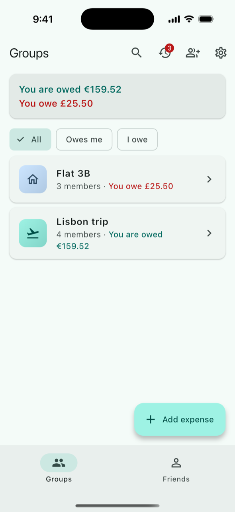
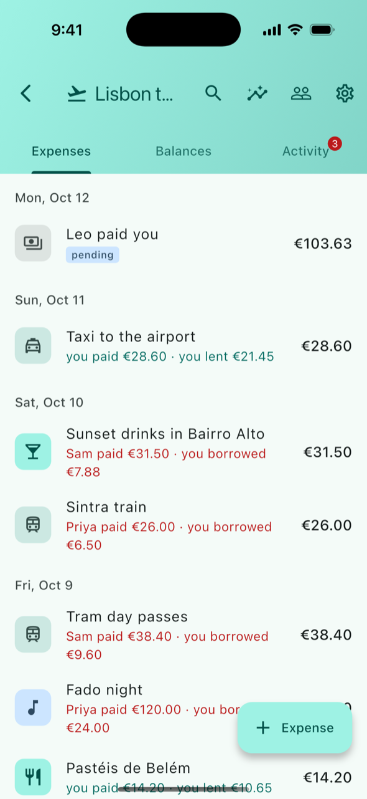
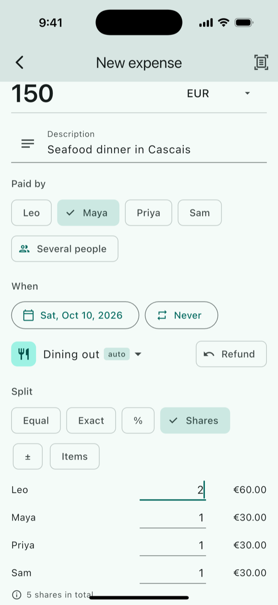
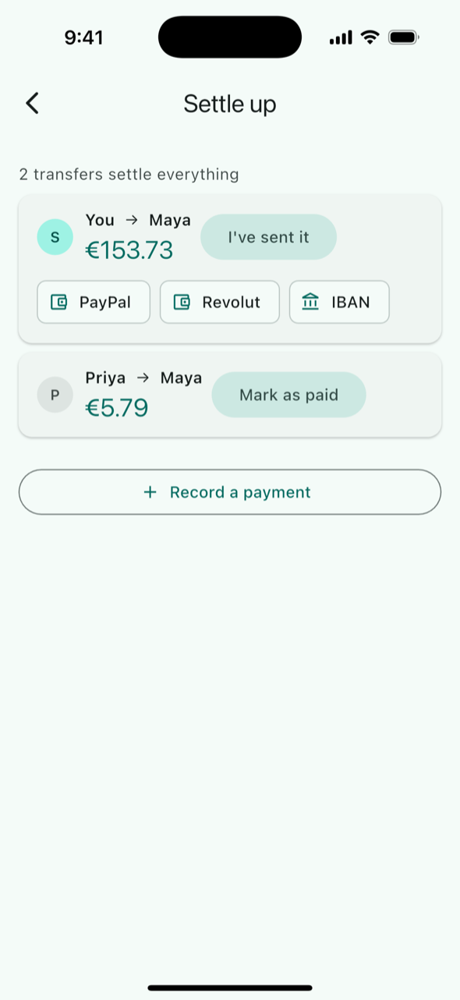
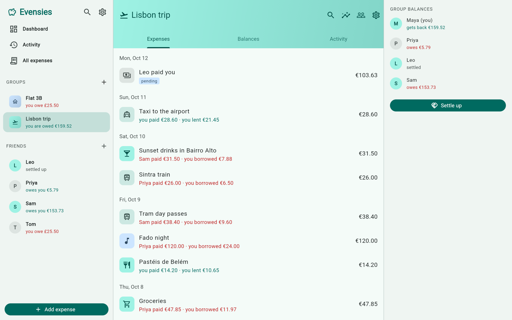

# Evensies

Split expenses with friends, roommates and travel companions: no daily limits, no ads, no paywall, no data lock-in.

[](https://github.com/devyourown/evensies/actions/workflows/ci.yml)
[](LICENSE)

An iOS, Android and web app (Flutter) with a small sync server (Spring Boot, Kotlin, PostgreSQL). Status: pre-release, not in the stores yet.

<table>
  <tr>
    <td></td>
    <td></td>
    <td></td>
    <td></td>
  </tr>
</table>



## Why

Splitwise's free tier limits how many expenses you can add per day, and you hit that limit on the first day of a trip. Most alternatives are web-only. Evensies is a native app where you can add expenses offline, the same app runs in the browser, and every feature is free.

## Promises

These are written down so they can't quietly change later:

1. **No limits on how many expenses you add, ever.** Not per day, not per group. The only caps are against abuse and far above real use (for example 50 members per group); see [docs/API.md](docs/API.md#daily-budget-and-rate-limits).
2. **No ads and no tracking.**
3. **Export is always available** (JSON and CSV). Your data leaves whenever you do.
4. **No paywall.** Every feature is free.
5. **Open source: Apache-2.0.**

## Features

- **Groups** for a trip, a home, a couple or anything else: invite by link, code, QR or email; add placeholder members who claim their name later; cover photos; delete and restore a group.
- **Friends:** expenses between two people outside any group, one balance per person across everything, reminders, block and report.
- **Six ways to split:** equally (untick who wasn't there), exact amounts, percentages, shares, adjustments, or by item from a receipt. Several payers, refunds and a default split per group.
- **155 currencies**, a different one per expense if you like, with automatic daily exchange rates and a home currency.
- **Settle up** with simplified debts (or as they arose, per group), pay links for PayPal, Wise, Venmo, Revolut, KakaoPay and UPI, an EU payment QR code or a copied IBAN or Korean bank account, and "sent" / "received" payments. Evensies never holds or moves money.
- **Stay in the loop:** activity feed, push notifications, comments, notes, edit history, restoring deleted expenses and payments, and an optional summary email.
- **Organise:** categories, search across all expenses, charts by month, category and person.
- **Receipts and repeats:** receipt photos, on-device text scanning (phones only), and repeating expenses for rent and subscriptions.
- **Your way:** add and edit expenses offline, 13 languages with local money and date formats, a web app, a home-screen widget, app lock, light and dark mode.
- **Accounts:** sign in with Apple, Google or a code sent by email; sign out everywhere; delete your account in Settings.
- **Export and import:** a group as JSON, CSV or a ZIP with its receipts, or everything as one JSON file; import a Splitwise CSV.

## How it works

- Every change is an event in an append-only log per group. The app pushes its queued events and pulls what's new; the server gives each event its place (`seq`) under a lock on the group.
- The app keeps a full local copy (SQLite through drift, IndexedDB on the web) and computes balances itself, so expenses and payments can be added and edited without a connection.
- Money is an integer in the currency's minor unit, and each expense stores the final amount per member.
- The Dart app and the Kotlin server implement the same rules, and the parts both sides have pass the same JSON test cases in [`shared/`](shared).
- The server also serves the web app at `/app/`, sends push notifications (Firebase Cloud Messaging) and, if configured, email.

More in [ARCHITECTURE.md](ARCHITECTURE.md); the API and sync contract is [docs/API.md](docs/API.md).

## Quick start

You need Flutter 3.41, JDK 21, Docker, and Xcode + CocoaPods (iOS), Android Studio (Android) or Chrome (web). Full steps, tests and the Android and web variants are in [CONTRIBUTING.md](CONTRIBUTING.md).

```sh
git clone https://github.com/devyourown/evensies.git && cd evensies
docker compose -f deploy/docker-compose.dev.yml up -d     # Postgres and Mailpit

# terminal 1: the server with the dev profile
export JAVA_HOME=/opt/homebrew/opt/openjdk@21/libexec/openjdk.jdk/Contents/Home   # or your JDK 21
cd server && ./gradlew --no-daemon bootRun --args='--spring.profiles.active=dev'

# terminal 2, from where you cloned: the app on the iOS simulator
cd evensies/app && flutter pub get
open -a Simulator
flutter devices                                            # find the simulator's device id
flutter run -d <device-id> --dart-define=DEV_LOGIN=true --dart-define=EVENSIES_SERVER_URL=http://localhost:8080
```

For the browser, use `flutter run -d chrome --web-port 7357` with the same `--dart-define`s: 7357 is the only origin the dev server allows. The Android emulator needs `http://10.0.2.2:8080` instead of `localhost` (see [CONTRIBUTING.md](CONTRIBUTING.md#3-app-on-a-simulator-or-emulator)).

On the login screen, type a name under "Dev name" and tap "Dev login". No Firebase files are needed; push is simply off without them.

## Repository layout

```
app/       Flutter app (iOS, Android, web)
server/    Spring Boot (Kotlin) API and sync server, also serves the web app
shared/    JSON test cases both implementations must pass, and the shared tables (currencies, categories, strings)
deploy/    Docker Compose for development and production, Caddy, .env.example
docs/      API and sync contract (API.md), privacy policy, store listing, release steps, design history
```

## Contributing

Bug reports, translation reviews and code are all welcome. Start with [CONTRIBUTING.md](CONTRIBUTING.md); issues labelled [good first issue](https://github.com/devyourown/evensies/labels/good%20first%20issue), when there are some, are small and self-contained. Please follow the [Code of Conduct](CODE_OF_CONDUCT.md), and report security problems privately as described in [SECURITY.md](SECURITY.md).

All 12 languages other than English are machine-translated and need native speakers to review them. That is the easiest way to help: see [Translations](CONTRIBUTING.md#translations).

## Running the server yourself

Apache-2.0 lets anyone run, change and redistribute the code, for any purpose. Only the name and the icon are restricted: see [TRADEMARKS.md](TRADEMARKS.md).

Store builds (once released) talk only to the official server. Your server serves the web app at `https://<your domain>/app/`, so that works right away. For phone apps that use your server, build them under your own name, icon and bundle id with `--dart-define=EVENSIES_SERVER_URL=https://<your domain>` ([build variables](docs/API.md#build-variables-app---dart-define)).

```sh
git clone https://github.com/devyourown/evensies.git && cd evensies/deploy
cp .env.example .env      # set EVENSIES_DOMAIN, EVENSIES_PUBLIC_URL, EVENSIES_JWT_SECRET, POSTGRES_PASSWORD and the sign-in client ids
docker compose up -d --build
```

Caddy gets a TLS certificate for `EVENSIES_DOMAIN` automatically, and a `backup` container writes a daily database dump to `deploy/backups/`. Set `EVENSIES_GOOGLE_WEB_CLIENT_ID` and `EVENSIES_APPLE_SERVICES_ID` to show Google and Apple sign-in in the web app, and `EVENSIES_SMTP_HOST` to turn on email. All variables: [docs/API.md](docs/API.md#environment-variables-server) and [server/README.md](server/README.md). `deploy/bootstrap.sh` prepares a fresh Ubuntu host.

## License and trademarks

Evensies is licensed under the [Apache License 2.0](LICENSE). Copyright 2026 Hyojun ([@devyourown](https://github.com/devyourown)) and contributors.

The name "Evensies", the logo and the app icon are not covered by the license; see the [trademark policy](TRADEMARKS.md).

Commits up to `3a71a8d` (2026-10-13) carry the license file they were published with: AGPL-3.0 up to `d3ac783`, then FSL-1.1-ALv2.
